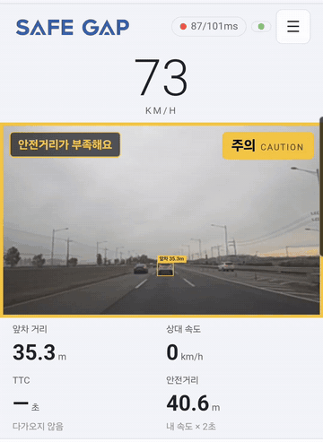
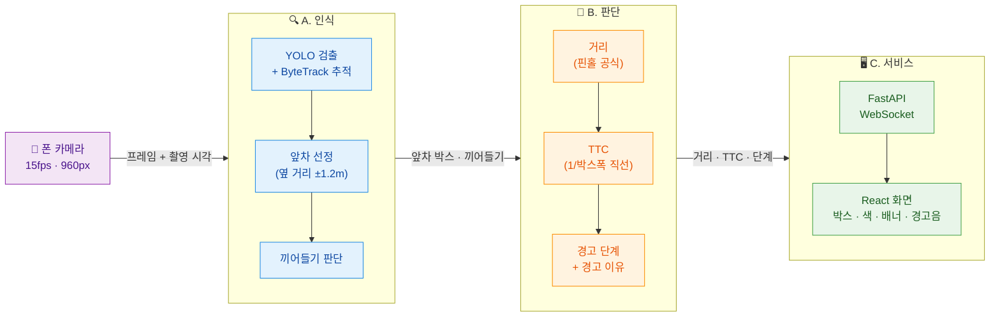
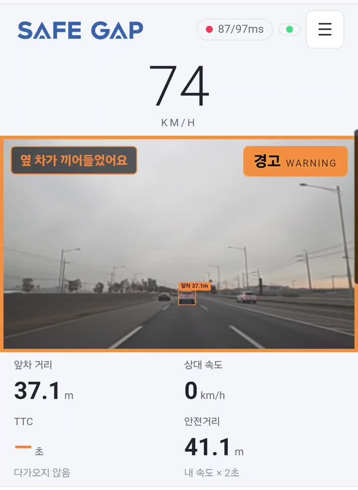

# SafeGap

> 폰 카메라 영상만으로 **앞차와의 거리와 충돌 위험을 실시간으로 경고**하는 서비스

<p align="center">
  
</p>

추가 센서(레이더·라이다) 없이 카메라 영상 하나로 앞차 거리, 충돌까지 남은 시간(TTC), 끼어들기를 판단하고, 위험도를 4단계(정상 · 주의 · 경고 · 위험)로 알려줍니다.

---

## 전체 흐름



**경고 4단계**

| 🟢 정상 | 🟡 주의 | 🟠 경고 | 🔴 위험 |
|:---:|:---:|:---:|:---:|
| 여유 있음 | 안전거리 부족 | TTC ≤ 3초 | TTC ≤ 1.5초 |

**역할 분담**

| 역할 | 담당 | 하는 일 |
|---|---|---|
| A. 인식 | 최상준 | 차량 검출·추적, 내 차선 앞차 선정, 끼어들기 판단 |
| B. 판단 | 혜민 | 앞차 거리, TTC, 경고 단계와 경고 이유 계산 |
| C. 통합·서비스 | 성아영 | 실시간 서버, 폰 화면, 경고 표시 |

**핵심 아이디어:** 학습된 깊이 추정 모델 없이, **핀홀 공식**(실제 차폭 ÷ 화면 속 박스 폭)으로 거리와 위치를 계산합니다. 가볍고, 동작을 설명하기 쉽습니다.

---

## A. 인식

```
프레임 → 본넷 잘라내기 → YOLO 검출 + ByteTrack 추적 → 차마다 옆 거리(m) → 앞차 선정 → 끼어들기 판단
```

- **검출·추적:** COCO 사전학습 YOLOv8s로 승용차·버스·트럭만 검출하고, ByteTrack으로 같은 차에 같은 ID를 붙입니다. 별도 학습은 하지 않았습니다.
- **앞차 선정:** 차가 정면에서 옆으로 몇 m 떨어졌는지를 핀홀 공식으로 계산합니다. ±1.2m 안의 차 중 가장 가까운 차를 앞차로 고릅니다.
  - 처음에는 사다리꼴 차선 영역을 썼지만, 영상마다 카메라 위치가 달라서 이 방식으로 바꿨습니다. 옆 방향 계산에서는 초점거리가 약분되어 카메라 화각을 몰라도 됩니다.
- **끼어들기:** 옆 차가 짧은 시간(0.17초) 동안 내 차선 쪽으로 0.3m 이상 들어오면 끼어들기로 봅니다. 프레임 수가 아니라 **시간 기준**이라 fps가 달라도 같은 기준이 적용됩니다.

## B. 판단

| 값 | 계산 |
|---|---|
| 거리 | 초점거리 × 차폭(1.8m) ÷ 박스 폭 |
| TTC | 최근 0.7초 동안의 `1/박스폭`을 시간에 대해 직선으로 맞춰, 0이 되는 시점 |
| 경고 단계 | TTC ≤ 1.5초 **위험**, ≤ 3초 **경고**, 안전거리(속도 × 2초) 부족 **주의**, 끼어들기 시 한 단계 ↑ |
| 경고 이유 | 끼어들기 / 급정거(접근 속도 ≥ 10m/s) / 안전거리 부족 |

- **TTC는 차폭·화각 오차에 강합니다.** 박스가 커지는 "비율"만 쓰기 때문입니다. KITTI에서 거리가 26% 틀린 구간에서도 TTC는 정답과 일치했습니다.
- **EMA → 직선 맞추기:** EMA는 정답 3.0초를 3.41초로 늦게 냈습니다(위험을 덜 위험하게 보고). 그래서 직선 맞추기로 바꿔 편향을 없앴습니다.
- **촬영 시각 기준:** 폰은 프레임 간격이 들쭉날쭉합니다. 모든 시간 계산을 실제 촬영 시각으로 바꿔, 불규칙한 간격에서도 TTC 오차가 0.004초였습니다.
- **현장 문제 보완:** 같은 차인데 ID가 바뀌는 경우는 박스 겹침으로 같은 차로 판단합니다. 검출이 0.2초 이내로 끊기는 경우는 직전 경고를 유지합니다. 경고가 깜빡이지 않게, 단계를 내릴 때만 0.15초 기다립니다.

## C. 서비스

```
폰(React) ─ 15fps, 960px JPEG + 촬영 시각 ─▶ FastAPI WebSocket ─▶ A → B ─▶ 결과 JSON ─▶ 폰 화면
```

- **지연이 쌓이지 않게:** 서버는 가장 최근 프레임 1장만 처리하고, 밀린 프레임은 버립니다.
- **이미지를 돌려보내지 않음:** 폰은 자기 카메라 화면을 그대로 보여주고, 서버는 결과(JSON)만 보냅니다.
- **서버가 멈추지 않게:** YOLO는 별도 스레드에서 돌립니다.
- **화면:** 앞차 박스와 거리, 경고 색과 배지, 경고 이유 배너, 경고음, GPS 속도(안 잡히면 슬라이더), 왕복 지연 표시.
- **판정은 B만 합니다.** 화면은 받은 값을 그대로 그리기만 합니다.

<p align="center">
  
  <br><sub>고속도로 실제 주행 중 폰 화면. 옆 차가 끼어들자 경고 단계가 한 단계 올라갔습니다.</sub>
</p>

---

## 결과

| 검증 | 결과 |
|---|---|
| KITTI (정답 거리 있음) · 뒷면이 보이는 앞차 | 거리 오차 −2 ~ −11% |
| KITTI · 앞차 접근 구간 | 경고 단계가 정답 기준과 8프레임 중 7프레임 일치 |
| 실제 주행 영상 · 끼어들기 장면 | 위험 경고 발생 (TTC 0.78초) |
| 폰처럼 프레임을 줄인 입력 (약 12fps) | 위험 구간 그대로 검출 |
| 주행 영상 클립 79개 · 앞차 검출 프레임 비율 | 낮 약 55%, 밤 19%, 새벽 13% |

## 한계와 개선 방향

- **밤·새벽 검출률이 낮습니다** → 야간 데이터로 YOLO 파인튜닝
- **차폭 1.8m 가정** → 트럭·경차는 거리 오차가 큽니다 (약 ±10%). 차종별 차폭 적용으로 개선할 수 있습니다.
- **비스듬한 차·옆 차선 차**는 박스에 옆면이 들어가 거리를 짧게 잡습니다.
- **카메라마다 본넷 비율과 정면 위치를 수동으로 설정**해야 합니다. 급커브에서는 앞차를 놓칠 수 있습니다.
- **폰 기종별 화각을 알 수 없어** 추정값(69°)을 씁니다. 다만 경고(TTC)는 영향을 받지 않습니다.
- 급정거는 브레이크등이 아니라 접근 속도로 판단합니다. 자동 재연결과 인증 기능은 아직 없습니다(시연용).

---

## 기술 스택

| 구분 | 기술 |
|---|---|
| 인식 | Ultralytics YOLOv8s, ByteTrack, OpenCV |
| 판단 | Python, NumPy |
| 서버 | FastAPI, uvicorn, Pydantic, WebSocket |
| 화면 | React 19, TypeScript, Vite |
| 환경 | Python 3.12, PyTorch 2.14 (CUDA 12.6) |
| 테스트 | pytest |

## 실행

```bash
# 1) 백엔드
cd backend
uvicorn app.main:app --reload            # http://localhost:8000

# 2) 프론트엔드
cd frontend
npm install
npm run dev                              # http://localhost:5173/?live (PC 웹캠)

# 3) 폰에서 접속 (카메라는 HTTPS에서만 열림)
cloudflared tunnel --url http://localhost:5173
# 출력된 https://xxxx.trycloudflare.com/?live 를 폰에서 열기

# 영상 파일 분석 / 테스트
python -m scripts.run_perception --video data/dev/sample.mp4 --camera configs/<카메라 설정>.yaml
pytest
```

## 데이터

KITTI, AI Hub 데이터와 주행 영상 원본은 라이선스상 저장소에 포함하지 않습니다. 공개 데모 영상의 번호판과 얼굴은 흐림 처리합니다.
